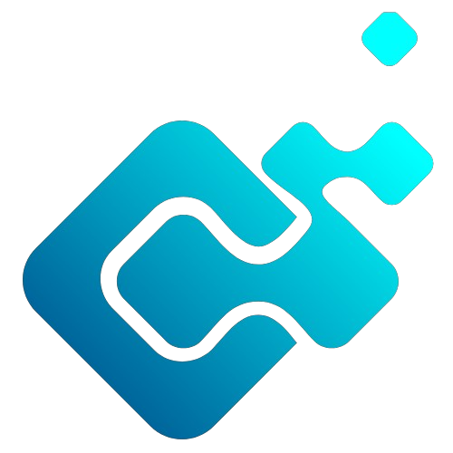

<div align="center">
  
  <h1>@m3rcena/bridge</h1>
  <h3>Universal Cross-Platform Gateway & Real-Time State Synchronizer</h3>
  <p>
    <b>Connect your Discord Bot Ecosystem to Web Dashboards, REST APIs, and WebSockets.</b><br>
    The shared, production-grade bridge standard for all <code>@m3rcena</code> packages.
  </p>

  <p>
    <a href="https://www.npmjs.com/package/@m3rcena/bridge">
      
    </a>
    <a href="https://discord.gg/U4E2Pn2wyn">
      
    </a>
  </p>
  <p>
    
    
    
    
    <a href="https://github.com/M3rcena/m3rcena-bridge/wiki">
      
    </a>
  </p>
</div>

> 📚 **Complete Documentation Wiki**: For detailed architecture guides, package router specs, and client SDK walkthroughs, visit the **[@m3rcena/bridge Official Wiki](https://github.com/M3rcena/m3rcena-bridge/wiki)**:
> - **[Architecture & Core Controller](https://github.com/M3rcena/m3rcena-bridge/wiki/Architecture)**
> - **[Installation & Submodules](https://github.com/M3rcena/m3rcena-bridge/wiki/Installation-and-Setup)**
> - **[Connecting Packages (@m3rcena/weky, @m3rcena/eco, custom)](https://github.com/M3rcena/m3rcena-bridge/wiki/Connecting-Packages)**
> - **[REST Endpoints & WebSocket Protocol](https://github.com/M3rcena/m3rcena-bridge/wiki/REST-and-WebSocket-API)**
> - **[Universal Client SDK & React Hooks](https://github.com/M3rcena/m3rcena-bridge/wiki/Client-SDK)**

---

## ⚡ Why @m3rcena/bridge?

Instead of implementing custom, duplicate bridge code inside each separate Discord bot package (`@m3rcena/weky`, `@m3rcena/eco`, etc.), **`@m3rcena/bridge`** provides a single, high-performance universal synchronization standard:

- 🌐 **Multi-Module Registry**: Mount multiple bot disciplines (`games`, `economy`, `moderation`, `custom`) on a single unified bridge gateway.
- 🔄 **Real-Time State Synchronization**: Live WebSocket push updates whenever sessions, matches, or inventories change.
- 🎮 **Cross-Platform Action Dispatching**: Seamlessly trigger game moves, economy transactions, or admin actions from Web Dashboards, REST APIs, or Discord bots with correlated response handling.
- 🔊 **Targeted Scoped Audio & Notifications**: Broadcast audio cues (MP3 sounds) and notifications strictly to the active player's browser session with presence filtering (`requireOnlinePresenceForAudio`).
- 👥 **User Presence Tracking**: Detect when dashboard users connect or disconnect with instant online/offline state.
- 💾 **Native SQLite & Enterprise Prisma Handlers**: Built-in zero-dependency local SQLite (`node:sqlite` WAL mode) and auto-migrating Prisma ORM storage adapters.
- 🦀 **Rust-Style Submodule Resolver**: Install and host via Git submodules locally with zero npm dependencies or transparently fall back to npm.
- 💻 **Universal Client SDK**: Ready-to-use client SDK exported directly via `@m3rcena/bridge/client` for Next.js, React, Vue, Electron, or Node.js.
- 🤖 **Discord.js v14.28.1 Ready**: Fully compatible with the latest Discord.js updates and `clientReady` lifecycle.

---

## 📦 Installation

### Option A: Via NPM Registry

```bash
npm install @m3rcena/bridge
# or
pnpm add @m3rcena/bridge
# or
yarn add @m3rcena/bridge
```

### Option B: Local Git Submodule (Rust-Style Resolver)

You can vendor and host `@m3rcena/bridge` locally via Git submodules without needing to publish or pull from npm:

```bash
git submodule add https://github.com/M3rcena/m3rcena-bridge.git submodules/m3rcena-bridge
```

Add auto-registration at the top of your app entrypoint:
```typescript
import "@m3rcena/bridge/register";
```

Or run standalone hosting:
```bash
npx tsx @m3rcena/bridge/host --port 4000
```

---

## 💾 Database Handlers & Storage Adapters

`@m3rcena/bridge` provides flexible, production-grade persistence adapters:

```typescript
import {
  M3rcenaBridge,
  SqliteBridgeStorage,
  PrismaBridgeStorage,
  JsonFileStorageAdapter,
  MemoryStorageAdapter,
} from "@m3rcena/bridge";

// 1. Zero-dependency Local SQLite (node:sqlite with WAL Mode)
const sqliteStorage = new SqliteBridgeStorage({ path: "./data/bridge.sqlite" });

// 2. Or Enterprise Prisma ORM Storage
// const prismaStorage = new PrismaBridgeStorage(prismaClient);

// 3. Or Lightweight JSON File Storage
// const jsonStorage = new JsonFileStorageAdapter("./data/bridge.json");

// Pass storage directly to Bridge controller
export const bridge = new M3rcenaBridge({
  storage: sqliteStorage,
  requireOnlinePresenceForAudio: true,
});
```

---

## 🚀 Quick Start: Server Side (Discord Bot or Backend)

### 1. Initialize the Core Bridge

```typescript
import { M3rcenaBridge, BridgeServer, SqliteBridgeStorage } from "@m3rcena/bridge";
import { WekyManager } from "@m3rcena/weky";
import { EcoManager } from "@m3rcena/eco";

// 1. Create Bridge Controller with SQLite WAL Persistence
export const bridge = new M3rcenaBridge({
  storage: new SqliteBridgeStorage({ path: "./data/bridge.sqlite" }),
  requireOnlinePresenceForAudio: true,
});

// 2. Connect packages seamlessly (Both constructor and fluent styles supported!)
// Style A: Pass bridge into managers
const weky = new WekyManager(client, { bridge });
const eco = new EcoManager({ bridge });

// Style B: Or chain on the bridge directly
// bridge.use(weky).use(eco);

// 3. Start the Real-Time WebSocket Server Gateway
const server = new BridgeServer(bridge, {
  port: 4000,
  path: "/bridge",
  secretToken: "your_secure_bridge_secret",
});

await server.start();
console.log("🚀 Bridge WebSocket Gateway running at ws://localhost:4000/bridge");
```

---

## 💻 Quick Start: Client Side (Web Dashboard / React / Next.js)

Import the lightweight client SDK directly:

```typescript
import { createBridgeClient } from "@m3rcena/bridge/client";

// 1. Connect to the Bridge (pass secretToken via query param or client config)
const client = createBridgeClient({
  url: "ws://localhost:4000/bridge?token=your_secure_bridge_secret",
  token: "your_secure_bridge_secret",
  userId: "1447491639550410796", // Authenticated Discord user ID
  username: "M3rcena",
  platform: "dashboard",
});

await client.connect();

// 2. Subscribe to live match or session state
const unsubscribe = client.subscribeSession("sess_fight_123", (newState) => {
  console.log("Live State Update:", newState);
  // Update your React / Vue state
});

// 3. Dispatch moves/actions directly from your dashboard UI
const result = await client.dispatchAction("games", "sess_fight_123", "hit");
console.log("Action Result:", result);

// 4. Listen for targeted sound cues
client.onAudioCue(({ soundKey, soundUrl }) => {
  new Audio(soundUrl).play();
});

// 5. Listen for real-time notifications
client.onNotification(({ title, message, type }) => {
  showToast(`${title}: ${message}`);
});
```

---

## 📊 Dashboard Overview Endpoint

Get a real-time overview of all connected users, active games, and system stats for your dashboard home screen:

```typescript
const overview = await bridge.getDashboardOverview();
console.log(overview);
/*
{
  activeModules: ["games", "economy"],
  onlineUsersCount: 14,
  onlineUsers: [{ userId: "123", username: "Alpha", platform: "dashboard" }],
  activeSessionsCount: 3,
  activeSessions: [...],
  uptime: 3600000,
  stats: { totalActionsDispatched: 85, totalSessionsCreated: 12 }
}
*/
```

---

## 📄 License

Distributed under the **Apache-2.0 License**. See [LICENSE](./LICENSE) for details.

<p align="center">
  Engineered with ❤️ by <b>M3rcena</b>
</p>
